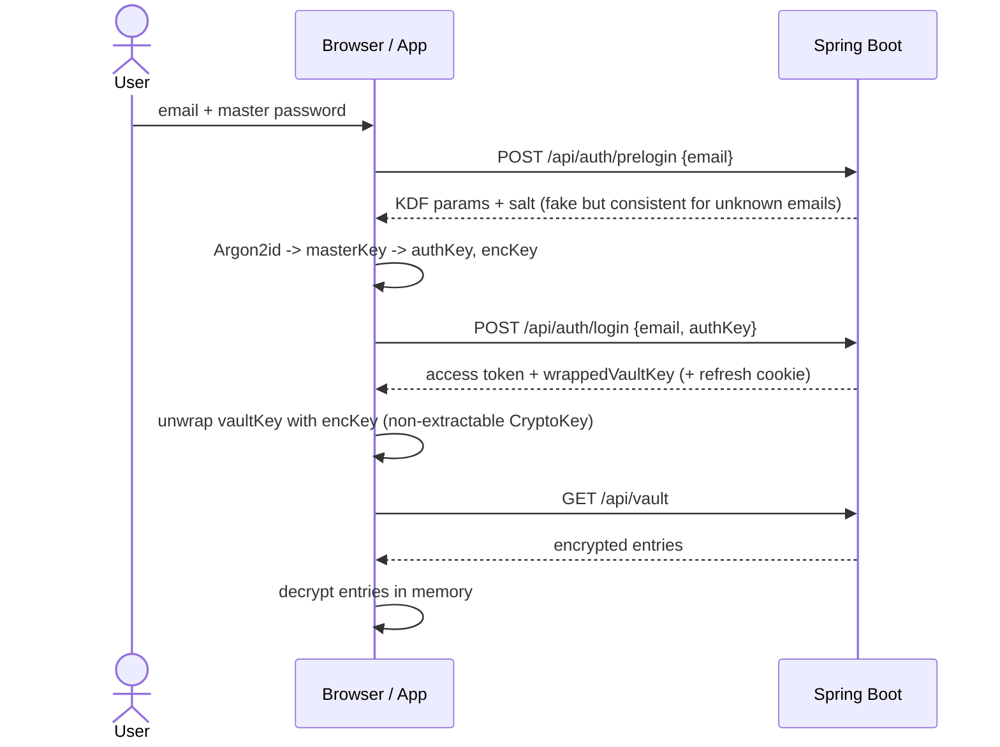
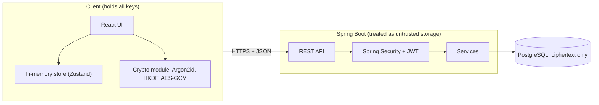

# PassManager

A zero-knowledge password manager built as a learning project: **Spring Boot + PostgreSQL** backend, **React + Vite** frontend, and an **Android app** (via Capacitor).

Your master password never leaves your device. Every vault entry is encrypted in the client before it is sent anywhere, so the server only ever stores ciphertext.

> **This is a learning project, not an audited security product.** Please don't store your real passwords in it. See [Known limitations](#known-limitations) for what is still unfinished.

<!-- Add screenshots here (blur emails/usernames first):
<p float="left">
  
  
  
  
</p>
-->

---

## Table of contents

- [Features](#features)
- [How it works](#how-it-works)
- [What the server can and cannot see](#what-the-server-can-and-cannot-see)
- [Security design](#security-design)
- [Tech stack](#tech-stack)
- [Project structure](#project-structure)
- [API overview](#api-overview)
- [Getting started](#getting-started)
- [Running the Android app](#running-the-android-app)
- [Testing](#testing)
- [Known limitations](#known-limitations)
- [Roadmap](#roadmap)

---

## Features

**Vault**
- Logins and secure notes, with favourites, categories and client-side search
- Password generator and passphrase generator
- TOTP (2FA) codes generated from a stored secret (RFC 6238)
- Password Checkup: weak and reused password detection (zxcvbn)
- Breach check using the HaveIBeenPwned k-anonymity API (only the first 5 characters of a SHA-1 hash are sent)
- JSON export and import

**Protection**
- Auto-lock after inactivity and when the app goes to the background
- Clipboard auto-clear after copying a password
- Masked passwords with a reveal toggle
- Change master password without re-encrypting any entries
- Optimistic concurrency (revision numbers) so edits never silently overwrite each other

**Platforms**
- Web app (Vite dev server or Nginx container)
- Android app (Capacitor), using a small `platform/` abstraction layer for storage, clipboard, biometrics and app lifecycle

---

## How it works

### Key hierarchy

```
masterPassword            (never leaves the device, never stored)
      |
      |  Argon2id(masterPassword, 16-byte random salt)
      v
masterKey                 (32 bytes, memory only)
      |
      +--> HKDF-SHA256, info = "pm/auth/v1" --> authKey   (sent to the server to log in)
      |
      +--> HKDF-SHA256, info = "pm/enc/v1"  --> encKey    (never sent; only wraps the vault key)

vaultKey                  (32 random bytes, generated once at registration)
      |   stored on the server as wrappedVaultKey = AES-256-GCM(encKey, vaultKey)
      v
each entry:  data = AES-256-GCM(vaultKey, entryJSON, AAD = "pm/entry/v1|<userId>|<entryId>")
```

- **Why two keys?** The server sees `authKey` to verify logins. If that were also the encryption key, the server could decrypt everything. HKDF with different `info` strings makes them independent.
- **Why a random vault key?** Changing the master password only re-wraps one 32-byte key. No entry needs to be re-encrypted.
- **Why AAD?** Binding each ciphertext to its user and entry ID means a compromised server can't swap one entry for another without decryption failing.
- **Encrypted format:** every ciphertext is stored as `v1.<base64 iv>.<base64 ciphertext+tag>`, with a fresh random 12-byte IV for every encryption.

### Login flow



### Architecture



---

## What the server can and cannot see

| The server stores | The server never sees |
|---|---|
| Email, KDF parameters and salt | Master password |
| Argon2id hash of the `authKey` | `encKey`, `vaultKey` |
| `wrappedVaultKey` (encrypted) | Any site, username, password or note in plaintext |
| Encrypted entry blobs, revision numbers, timestamps | Anything searchable about entry contents |
| IP and user agent (audit events) | |

If the database is fully leaked, an attacker gets ciphertext and slow-to-crack hashes.

---

## Security design

| Area | What the code does |
|---|---|
| Key derivation | Argon2id via `hash-wasm` (64 MiB, 3 iterations, parallelism 1); PBKDF2-SHA256 (600k iterations) as a fallback |
| Encryption | AES-256-GCM through Web Crypto, 96-bit random IV every time, AAD binding |
| Key separation | HKDF-SHA256 with distinct `info` strings for auth and encryption keys |
| Vault key in memory | Imported as a **non-extractable** `CryptoKey`; raw bytes are zeroed after import (best effort in JS) |
| Server-side auth hash | Spring `Argon2PasswordEncoder` over the `authKey`, with encoding upgrade support |
| Anti-downgrade | Server rejects KDF parameters weaker than the configured minimums |
| Account enumeration | Deterministic fake prelogin response (HMAC of the email) and a dummy hash check for unknown emails |
| Brute force | Per-IP and per-IP+email rate limits (Bucket4j), account lockout after 5 failures for 15 minutes |
| Lockout correctness | Failed attempts are recorded in a separate `REQUIRES_NEW` transaction so they survive the exception rollback |
| Sessions | 15-minute JWT access tokens (HS256) held in memory only; refresh tokens stored server-side only as SHA-256 hashes and rotated on every use |
| Tenant isolation | Every vault query is scoped by the authenticated user's ID; another user's entry returns `404`, never `403` |
| Input validation | Strict DTO validation, unknown JSON fields rejected, ciphertext format validated by regex |
| Responses | `Cache-Control: no-store` on all API responses; no stack traces or SQL in errors |
| Frontend hygiene | No `dangerouslySetInnerHTML`; decrypted data lives in memory only |

---

## Tech stack

| Layer | Technology |
|---|---|
| Backend | Java 21, Spring Boot 3.3, Spring Security (OAuth2 resource server for JWT), Spring Data JPA, Bean Validation |
| Database | PostgreSQL 16, Flyway migrations |
| Rate limiting | Bucket4j + Caffeine |
| Frontend | React 19, TypeScript, Vite, Zustand, Tailwind |
| Crypto | Web Crypto API, `hash-wasm` (Argon2id), `@zxcvbn-ts` (strength) |
| Mobile | Capacitor 8 (Android), secure storage, biometric prompt, clipboard and app plugins |
| Testing | Vitest (frontend crypto), JUnit 5 (backend) |
| Tooling | Docker, docker-compose, Maven wrapper |

---

## Project structure

```
PassManager/
├── backend/                     Spring Boot API
│   └── src/main/java/com/example/passwordmanager/
│       ├── config/              Security, JWT, CORS, no-store filter, typed properties
│       ├── controller/          Auth, Vault, Me
│       ├── dto/                 Request/response records
│       ├── entity/              User, VaultEntry, RefreshToken, AuditEvent
│       ├── repository/          User-scoped queries
│       ├── security/            Token service, rate limiter, client IP resolver
│       ├── service/             Auth, Vault, Lockout, Audit, Prelogin
│       └── validation/          Custom validators (@EncString, @Base64Bytes, @ValidKdf)
├── frontend/
│   ├── src/
│   │   ├── crypto/              kdf, hkdf, aead, vaultKey, entryCrypto (+ tests)
│   │   ├── api/                 fetch client with single-flight token refresh
│   │   ├── services/            vaultService: the only place crypto and API meet
│   │   ├── platform/            storage, clipboard, biometric, lifecycle (web vs native)
│   │   ├── store/               Zustand session store
│   │   ├── features/            Unlock, Vault, Entry detail, Checkup screens
│   │   ├── components/          Modals, toasts, generator
│   │   └── lib/                 TOTP, HIBP check, password strength, generators
│   └── android/                 Capacitor Android project
├── scripts/                     setup-env.js, run-api.js
├── docker-compose.yml           PostgreSQL for local development
└── .env.example
```

Design rule: UI components never call `crypto.subtle` or `fetch` directly. They go through `vaultService`.

---

## API overview

Base path: `/api`. JSON in and out. Errors use RFC 7807 `ProblemDetail` with an extra `code` field.

| Method | Path | Auth | Purpose |
|---|---|---|---|
| POST | `/auth/prelogin` | none | Get KDF parameters and salt for an email |
| POST | `/auth/register` | none | Create account (auth key, KDF params, wrapped vault key) |
| POST | `/auth/login` | none | Verify auth key, issue tokens |
| POST | `/auth/refresh` | refresh token | Rotate refresh token, issue new access token |
| POST | `/auth/logout` | refresh token | Revoke the token family |
| POST | `/auth/change-password` | Bearer | Re-wrap vault key under a new password, revoke all refresh tokens |
| GET | `/me` | Bearer | Current user summary |
| GET | `/vault` | Bearer | List encrypted entries |
| POST | `/vault` | Bearer | Create entry |
| PUT | `/vault/{id}` | Bearer | Update entry (requires current `revision`) |
| DELETE | `/vault/{id}` | Bearer | Delete entry |

Status codes worth knowing: `409` for revision conflicts and duplicate emails, `422` when the per-user entry quota is exceeded, `429` with `Retry-After` when rate limited.

---

## Getting started

### Prerequisites

- Node.js 20+ and npm
- Java 21
- Docker (for the local PostgreSQL container)

### Quick start

```bash
git clone https://github.com/Anmol007-max/PassManager.git
cd PassManager
npm install          # also installs the frontend dependencies
npm start            # creates .env, starts PostgreSQL, then the API and the web app together
```

Then open **http://localhost:5173** and create a vault.

`npm start` runs these steps:

1. `npm run setup` creates a `.env` with freshly generated random `JWT_SECRET` and `PRELOGIN_SECRET`
2. `npm run db:up` starts PostgreSQL 16 in Docker
3. `npm run api` starts Spring Boot on port 8080 (dev profile)
4. `npm run web` starts the Vite dev server on port 5173, proxying `/api` to the backend

Other useful commands:

```bash
npm run start:nodb   # same, but without Docker (use your own PostgreSQL)
npm run db:down      # stop the database container
npm run test:api     # run backend tests
```

### Configuration

Copy `.env.example` to `.env` and fill in real values if you don't use `npm run setup`.

| Variable | Description |
|---|---|
| `DB_URL`, `DB_USER`, `DB_PASSWORD` | PostgreSQL connection |
| `JWT_SECRET` | Base64 of at least 32 random bytes (HS256 key) |
| `PRELOGIN_SECRET` | Base64 of at least 32 random bytes (HMAC key for fake prelogin responses) |
| `APP_CORS_ORIGINS` | Comma-separated exact origins allowed by CORS |
| `VITE_API_BASE` | (Frontend / Android) base URL of the API |

Generate a secret with `openssl rand -base64 32`. Never commit a real `.env`.

---

## Running the Android app

Requires Android Studio, an emulator or device, and a backend reachable from it.

```bash
# 1. Point the app at your backend (HTTPS in production)
echo "VITE_API_BASE=http://<your-lan-ip>:8080" > frontend/.env.production

# 2. Build the web bundle and sync it into the Android project
npm run cap:build

# 3. Open in Android Studio, or run directly
npm run cap:open
npm run cap:run
```

On Android the app uses secure storage for the refresh token and the platform clipboard and lifecycle plugins. See [Known limitations](#known-limitations) for the current state of biometric unlock and the development-only cleartext networking setup.

---

## Testing

```bash
# Frontend crypto tests (Vitest)
cd frontend && npx vitest run

# Backend unit tests
npm run test:api
```

**Frontend crypto tests cover:** encrypt/decrypt round trip, wrong key, flipped ciphertext bit, wrong AAD, unique IVs, IV length and parser rejection of malformed input, auth key vs encryption key separation, deterministic derivation, vault key wrap/unwrap, and known-answer vectors for HKDF and PBKDF2.

**Backend tests cover:** DTO validation rules, deterministic fake prelogin responses, and token hashing and expiry logic.

---

## Known limitations

This project is still being hardened. Being upfront about what isn't done:

- **Biometric unlock is a UI gate.** The fingerprint prompt decides whether the app reads the vault key from secure storage; the key is not bound to a user-authentication-required Android Keystore key.
- **Export is plaintext JSON.** The exported file is not encrypted, so treat it carefully and delete it after use.
- **Refresh-token reuse detection is untested.** The code revokes a token family when a used token is replayed, but there is no integration test proving the revocation persists (the surrounding transaction may roll it back).
- **Integration tests and CI are missing.** There are no Testcontainers-based API tests or CI pipeline yet.
- **Rate limiting is in-memory,** so it only works correctly for a single backend instance.
- **Mobile refresh token** is returned in the JSON body and kept in secure storage (a deliberate tradeoff, since there is no HttpOnly cookie jar on native). The web app uses an HttpOnly cookie.
- **Development networking is permissive.** The Android build currently allows cleartext HTTP and the CORS list includes local-network origins. Use HTTPS and tighten both for any real deployment.
- **No account recovery.** If you forget your master password, your data cannot be recovered. This is inherent to the zero-knowledge design.
- **Out of scope:** malware or keyloggers on the device, a fully compromised browser, and weak master passwords.

---

## Roadmap

- [ ] Bind biometric unlock to an Android Keystore key that requires user authentication
- [ ] Encrypted export protected by a separate password
- [ ] Backend integration tests (Testcontainers) and GitHub Actions CI
- [ ] `FLAG_SECURE` and a release network security config (HTTPS only)
- [ ] Remove default secrets from configuration and fail fast when they're missing
- [ ] Offline recovery key
- [ ] Browser extension with autofill

---

## Acknowledgements

Built to learn how password managers like Bitwarden approach client-side encryption, and to practice secure API design with Spring Boot.
